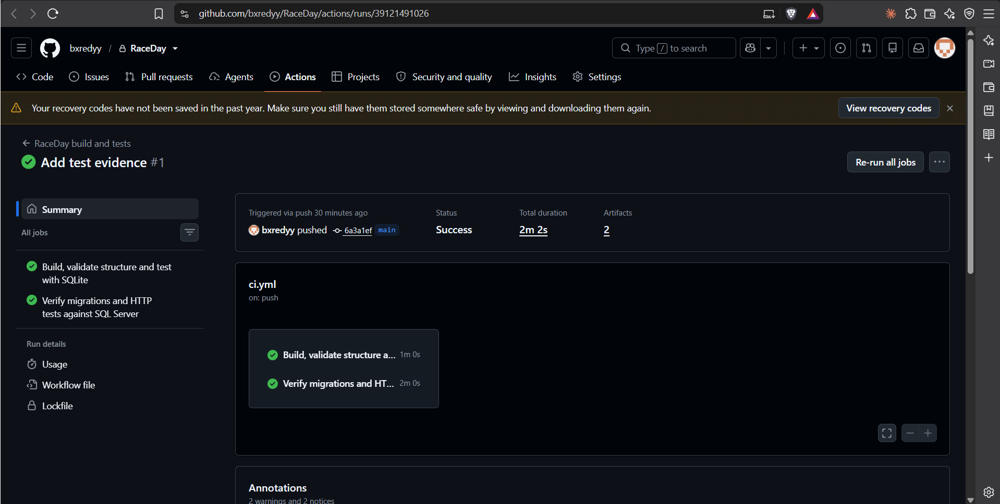

# RaceDay

Mukona Mamaila  
ST10494639  
PROG6212 Part 2

RaceDay is an API for running, walking and cycling events. Organisers can manage their events, categories and results. Participants can register, enter events and view their own results.

The project uses C#, ASP.NET Core, SQL Server and Entity Framework Core. The folders separate the endpoints, business rules and database work. [14] Swagger is used to try requests and check the responses. [16]

## Video and build

- YouTube video: https://youtu.be/AevTd0TqWYo
- GitHub Actions: [passed](https://github.com/bxredyy/RaceDay/actions/runs/39121491026)



## What you need

- .NET 10 SDK [9]
- Visual Studio 2026 with ASP.NET and web development installed [9]
- SQL Server or SQL Server LocalDB

## Run the project

1. Open `RaceDay.sln` in Visual Studio 2026.
2. Allow Visual Studio to restore the NuGet packages.
3. Open `appsettings.json` under `RaceDay.Api`.
4. Set the connection string to your SQL Server instance.
5. Set up the database using the steps below.
6. Right-click `RaceDay.Api` and select **Set as Startup Project**.
7. Select **Build > Build Solution**.
8. Press the green play button. Swagger opens at http://localhost:5080/swagger.

The LocalDB connection string used during testing was:
"RaceDay": "Server=(localdb)\\RaceDayLocalDB;Database=RaceDay;Trusted_Connection=True;TrustServerCertificate=True"


## Database
Database
The database has six main tables: Users, Events, Categories, Enrolments, Results and AuditLogs.

For the first setup:
1. Open View > SQL Server Object Explorer in Visual Studio.
2. Connect to the SQL Server instance used in appsettings.json.
3. Right-click the server and select New Query.
4. Copy the contents of docs/RaceDay.sql into the query editor.
5. Execute the script. It creates the RaceDay database, tables and demo data.
If the database is already set up, you can start the API without repeating these steps.

The EF migration is in Part2/RaceDay.Api/Data/Migrations
## Demo accounts

The password for these accounts is `RaceDay!Demo2026`.

| Email | Role |
|---|---|
| organiser1@raceday.example | Organiser |
| organiser2@raceday.example | Organiser |
| participant1@raceday.example | Participant |
| participant2@raceday.example | Participant |

These are demo accounts. You can also register a new account with either role. The two roles have different permissions, following role-based access control. [11]

## Try it in Swagger

1. Open `POST /api/auth/login`, click **Try it out** and log in with a demo account.
2. Run `GET /api/users/profile` to check the logged-in account.
3. As an Organiser, create an event and add a category. Keep the returned IDs.
4. Log out and log in as a Participant.
5. Enter the event using `POST /api/enrolments` and check `GET /api/enrolments/my-enrolments`.
6. Try creating an event as a Participant. This should return 403.
7. Log out and try viewing the profile. This should return 401.

Swagger sends the session cookie automatically. You do not need to paste a bearer token. Session handling follows the ASP.NET Core setup. [1]

HTTP codes show the result of a request. For example, 201 means a record was created, 401 means login is required or invalid, 403 means access is refused and 409 means a conflict with existing data. [12]

Example event:

```json
{
  "name": "Pretoria Community Run",
  "description": "A community road running event.",
  "eventDate": "2030-11-15T06:00:00Z",
  "location": "Pretoria",
  "distanceKm": 10,
  "eventType": "Run",
  "bannerImageUrl": null
}
```

Use a future date for a new event. Dates use UTC, distances are in kilometres and fees are in rand. Passwords must be 12 to 128 characters long.

The demo data also has a completed walk. Organiser 1 can use its enrolment list to find Participant 2's entry and add a result. Use the actual enrolment ID from the response. An example finish time is `00:48:00`, with overall position 2 and category position 2.

The full endpoint list is in [endpoint plan](docs/endpoint-plan.md).

## Tests

To run the tests in Visual Studio:

1. Stop the API if it is running.
2. Open **Test > Test Explorer**.
3. Click **Run All Tests**.
4. Check the results for any failures.

The tests follow arrange, act and assert: prepare the data, perform an action and check the result. [13] Most are integration tests that send requests to the API and check its behaviour with a database. [3]

Test Explorer uses SQLite by default. Changing the API connection string does not change the test database.

The saved Windows SQL Server test report records 74 passed tests. SQL Server tests create separate databases with names starting with `RaceDayTests_` and remove them afterwards.

GitHub Actions builds the solution and runs the tests with SQLite and SQL Server. The SQL Server job also runs the database script twice to check that demo data is not duplicated.

The saved SQL Server test report is in `docs/evidence/windows-sqlserver-tests.trx`. The successful GitHub Actions screenshot is in `docs/evidence/ci-green.png`.

## Folders

| Folder | What it contains |
|---|---|
| Controllers | API endpoints and role checks |
| Contracts | Request and response classes |
| Models | Database models |
| Services | Validation and business rules |
| Security | Session login and current user details |
| Data | EF context, migrations and demo data |
| Middleware | API error handling |
| RaceDay.Tests | Automated tests |
| docs | ERD, endpoint plan, SQL and project notes |
| .github/workflows | GitHub Actions workflow |

The code keeps the basic namespace and comment style from the earlier C# project. [8]

## Main decisions

- Login stores the user ID and role in a server-side session. The database is checked again when the user makes an authenticated request. Sessions expire after 30 minutes without activity. [1]
- The brief gives Organisers and Participants different permissions. [6] Role-based access control checks the assigned role before allowing an action. [11], [18] RaceDay also checks ownership for organiser actions and personal histories.
- Passwords are saved as salted hashes using `PasswordHasher`, not as plain text. [5]
- The database blocks duplicate entries and duplicate results. A category must belong to the event being entered. [2], [10]
- Events and categories with enrolments cannot be deleted because their history is still needed.
- Finish times use SQL Server `time`, as in the Part 1 plan. [7] The API accepts times from `00:00:01` to `23:59:59`.
- Sessions are held in memory in this version, so restarting the API clears them. Multiple servers would need shared session storage.
- MVC, Azure Blob Storage and Docker are planned for Part 3. [6]

## Common problems

| Problem | What to check |
|---|---|
| .NET 10 is missing in Visual Studio | Open Visual Studio Installer, select Modify and install the .NET 10 SDK and ASP.NET workload |
| Cannot connect to SQL Server | Check the instance name and that it is running |
| 401 response | Log in again in the same browser |
| 403 response | Check the account role and who owns the event |
| 409 response | Check for a duplicate entry, duplicate category or an event with enrolments |
| Swagger does not open | Check that the API is running and listening on port 5080 |

## AI use

AI tools helped with planning, code, tests, debugging and documentation.

## References

The numbered sources are listed in [references](docs/references.md). GeeksforGeeks is used for the main concepts, with Microsoft and Swashbuckle documentation for the framework details.
